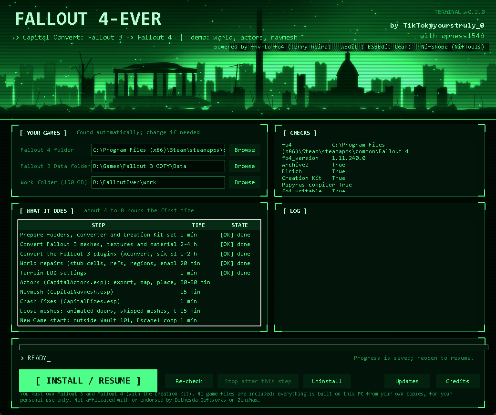

# Fallout 4-Ever

**Walk the Capital Wasteland in Fallout 4.** A one-click program that builds the Fallout 3 world inside *your own* copy of Fallout 4, from *your own* copy of Fallout 3.
By TikTok@yourstruly_0, with opness1549. Free, MIT-licensed scripts, no game files included.

> **This is a demo release.** It builds the **world, the actors and the navmesh** (the whole Capital Wasteland and the five DLC worlds, with NPCs and creatures placed where they stood
> in Fallout 3, and working navigation) plus a **New Game start outside Vault 101**. Quests, dialogue, voice, music, radio, weather and NPC faces are **not** in it yet:
> see [docs/ROADMAP.md](docs/ROADMAP.md) for exactly what is missing and [docs/FAQ.md](docs/FAQ.md) for what works.

## What you get
* A Fallout 3 world loading in Fallout 4: terrain, buildings, interiors, doors, terminals (locked ones stay locked), about 4,260 placed NPCs and creatures, 7,198 navmeshes.
* **New Game** skips Fallout 4's pre-war intro: you arrive right outside Vault 101 with a Pip-Boy, the quest *Escape!* already completed, then the character editor and the SPECIAL screen.
* Fast travel by console to anywhere: for example `~` then `coc MegatonPlaza`, `coc TheMallMonument`, `coc RivetCityExterior04`.

## What you need
| | |
|---|---|
| **Fallout 3** | *Game of the Year Edition* with all five DLC (Steam, GOG or Epic) |
| **Fallout 4** | Steam, version 1.11.x, plus the free **Fallout 4 Creation Kit** (Steam, Tools). Run the Creation Kit once so it sets itself up. |
| **PC** | Windows 10 or 11 (64-bit), **150 GB free disk space** (most of it temporary), 32 GB RAM recommended |
| **Time** | about **4 to 8 hours** the first time. The PC is busy but it runs by itself. |
| **Internet** | once, to download two free tools (about 136 MB); later only when you press *Check for updates* |

You must own the games. **No game files are included or shared**: everything is built on your PC from your own copies, for your personal use.

## Install in 4 steps
1. Download `CapitalConvert-x.y.z.zip` from the [Releases page](https://github.com/shade2363/Fallout-4-Ever/releases) and unzip it anywhere (not inside a game folder).
   Optional but recommended: compare the zip's SHA-256 with `SHA256SUMS.txt` on the same page.
2. Close Fallout 3, Fallout 4 and the Creation Kit. Double-click **`CapitalConvert.exe`**.
3. Check the green panel (your games should be found automatically; use *Browse* if not), then click **INSTALL / RESUME**.
4. Wait. When it says **FINISHED**, start Fallout 4 from Steam and choose **New Game** (Fallout 4 asks you to confirm because mods are loaded; press Enter).

You can close the window at any time; press **INSTALL / RESUME** again and it carries on where it stopped.
Detailed steps: [docs/INSTALL.md](docs/INSTALL.md). If anything goes wrong: [docs/TROUBLESHOOTING.md](docs/TROUBLESHOOTING.md).

## Updating, removing, safety
* **Updates:** the *Updates* button checks this repository's releases. Updates are signed; only the steps whose scripts changed run again. [docs/UPDATE.md](docs/UPDATE.md)
* **Uninstall:** the *Uninstall* button removes **only** the files it installed, puts back anything it replaced, and restores your settings. Your Fallout 3 and Fallout 4 game files are never modified.
* **Safe by design:** it needs no administrator rights, adds no background services, sends no data anywhere, and only connects to the internet to download two tools (hash-checked) and when you press *Check for updates*.

## Documentation
| | |
|---|---|
| [docs/INSTALL.md](docs/INSTALL.md) | step-by-step install, what it changes, uninstall |
| [docs/UPDATE.md](docs/UPDATE.md) | how updates work, rollback, command line |
| [docs/TROUBLESHOOTING.md](docs/TROUBLESHOOTING.md) | every message you might see, and the fix |
| [docs/FAQ.md](docs/FAQ.md) | common questions |
| [docs/SCRIPTS.md](docs/SCRIPTS.md) | which scripts ship and why |
| [docs/ARCHITECTURE.md](docs/ARCHITECTURE.md) | how the program works inside |
| [docs/BUILD-FROM-SOURCE.md](docs/BUILD-FROM-SOURCE.md) | run and build it yourself |
| [docs/ROADMAP.md](docs/ROADMAP.md) | what is done and what is not |
| [docs/LEGAL.md](docs/LEGAL.md) | legal notes |
| [CREDITS.md](CREDITS.md) | the teams whose software this builds on |
| [CONTRIBUTING.md](CONTRIBUTING.md), [SECURITY.md](SECURITY.md) | contribute, report a vulnerability |

## Legal
Not affiliated with or endorsed by Bethesda Softworks or ZeniMax Media. Fallout, Fallout 3 and Fallout 4 are their trademarks.
Free, personal use only; **do not redistribute anything the tool builds**. Our scripts are under the [MIT licence](LICENSE); third-party tools keep their own licences: [CREDITS.md](CREDITS.md).
More in [docs/LEGAL.md](docs/LEGAL.md).
